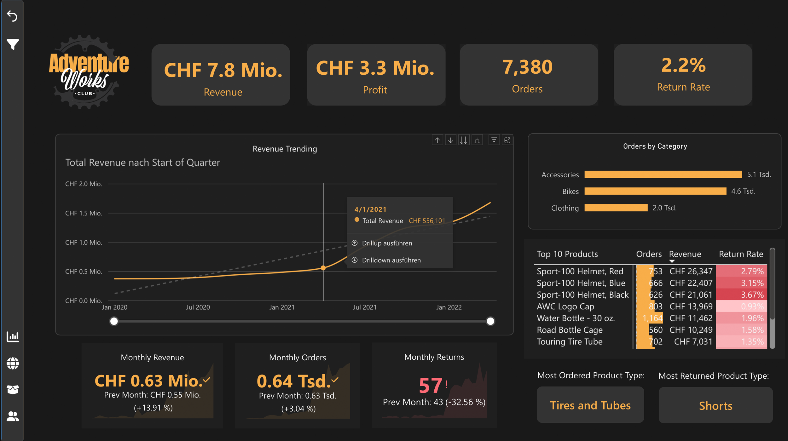
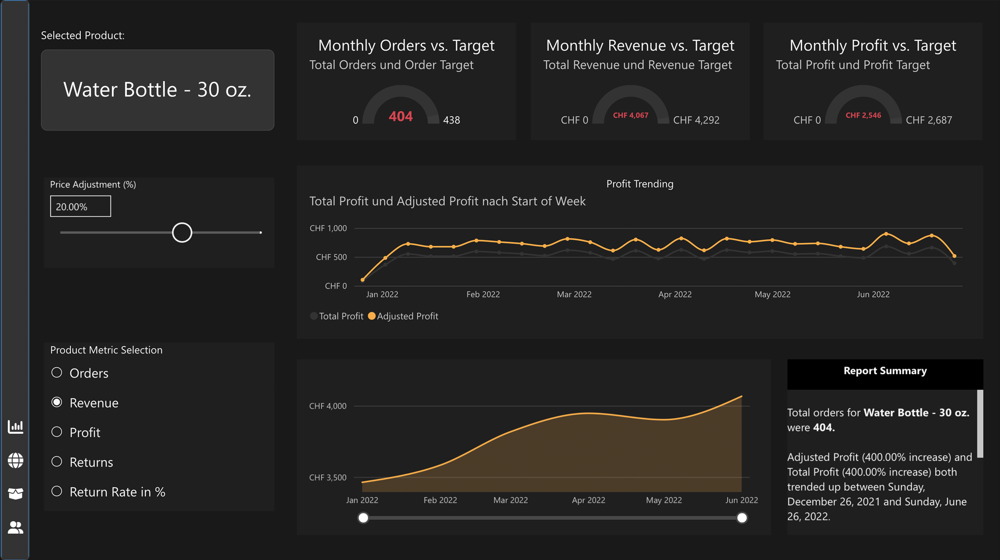
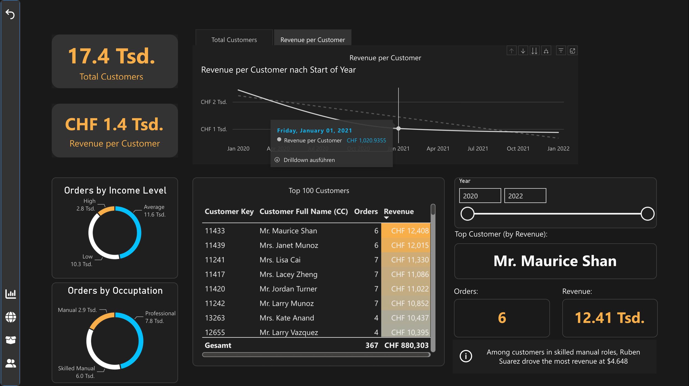

# AdventureWorks Sales Analysis

An interactive business intelligence dashboard built with Power BI to analyse sales performance, profitability, customers, products and returns using the AdventureWorks sample dataset.

## Table of Contents

- [Project Background](#project-background)
- [Data Structure](#data-structure)
- [Dashboard](#dashboard)
- [Key Findings](#key-findings)
- [Recommendations](#recommendations)
- [Tools & Skills](#tools--skills)
- [Dataset](#dataset)

---

## Project Background

AdventureWorks is a fictitious bicycle manufacturer and retailer operating across North America, Europe and the Pacific region. Its sales data provides a basis for analysing revenue, profitability, product performance and customer behaviour across markets.

The dashboard brings together key performance indicators and interactive visualisations to support the analysis of revenue, profit, order activity and product returns. It also includes tools for exploring customer and product performance in greater detail.

## Data Structure

The AdventureWorks dataset contains business data related to sales, products and customers. The report combines relevant information to analyse performance across different dimensions.

The dashboard covers the following areas:

| Data Area | Purpose |
|---|---|
| Sales | Analyse revenue, order activity and sales trends |
| Products | Compare product and category performance |
| Customers | Explore customer-related metrics and purchasing patterns |
| Returns | Monitor product returns and return rates |
| Time | Analyse performance over time |
| Geography | Explore the geographic distribution of business activity |

## Dashboard

[**Open the interactive Power BI report**](https://app.powerbi.com/view?r=eyJrIjoiYTFmNzI1ZmEtMjIwNy00ODliLWJkMzgtZTIzOTZkYmRkODdhIiwidCI6Ijk3NDdjNzczLTkyM2QtNGNjMi04MGRiLTEzNGI0MGExZDgxYiJ9)

The report includes several views for analysing business performance:

- **Overview:** Key performance indicators, including revenue, orders, profit and return rate
- **Geographic Analysis:** Visualisation of business performance by location
- **Time Analysis:** Trends and changes in performance over time
- **Product Analysis:** Comparison of products and product performance
- **Customer Analysis:** Exploration of customer-related metrics
- **Advanced Analytics:** Decomposition Tree and Key Influencers for exploring factors associated with selected metrics

Interactive filters, navigation and drillthrough functionality allow users to move from an overview to more detailed analyses. Dynamic metric selection provides additional flexibility when exploring the data.

## Key Findings

*The following findings focus on the European market, based on the AdventureWorks dataset.*

### Sales Performance

- Between January 2020 and June 2022, the European market generated approximately CHF 7.8 million in revenue and CHF 3.3 million in profit.
- Revenue declined noticeably between June and November 2020, coinciding with the COVID-19 pandemic. This was followed by a sharp increase in revenue. Possible explanations include successful promotional campaigns or increased demand as people returned to outdoor activities such as cycling after pandemic restrictions eased.

### Product Performance and Returns

- Tires and tubes are the most frequently ordered product type, while cycling shorts have the highest number of returns.
- Sport helmets are the top revenue-generating products. However, black sport helmets also have the highest return rate, suggesting a potential area for further investigation.

## Recommendations

1. **Revenue Growth:** Investigate the sharp increase in revenue following the decline in 2020 to identify potential drivers, such as promotional campaigns or increased demand for cycling products. Use these insights to inform future sales and marketing strategies.
2. **Product Returns:** Investigate the high return rate of black sport helmets to determine whether it is associated with product quality, sizing, customer expectations or product-specific issues.
3. **Product Performance:** Maintain the availability of high-demand products, particularly tires and tubes, while reviewing return patterns across product categories to identify opportunities to improve customer satisfaction.

## Tools & Skills

- **Power BI:** Interactive dashboard development and data visualisation
- **Power Query:** Data transformation and preparation
- **DAX:** Measures and calculated metrics
- **Data Modelling:** Relationships and analytical data structures
- **Business Intelligence:** KPI analysis, drillthrough and interactive reporting
- **Advanced Visuals:** Decomposition Tree and Key Influencers

## Dataset

This project uses the AdventureWorks sample dataset provided by Microsoft.

The dashboard was developed in Power BI.
